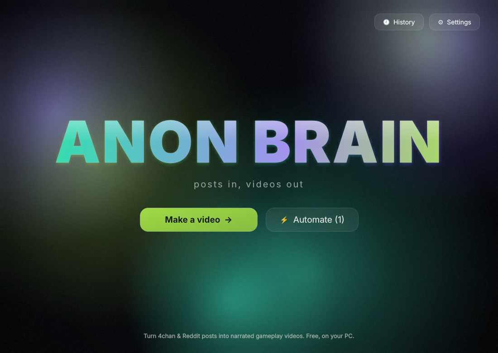
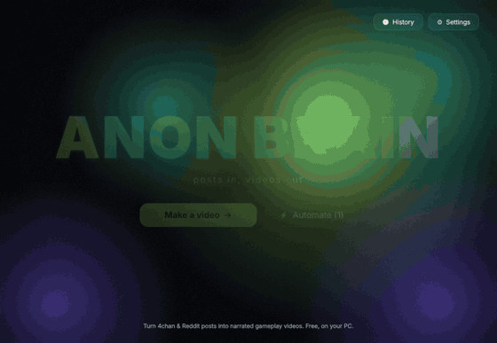
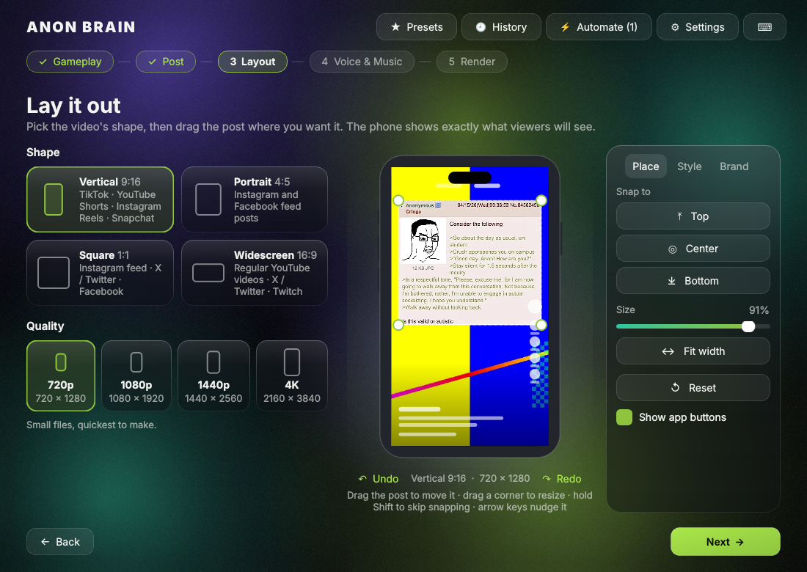
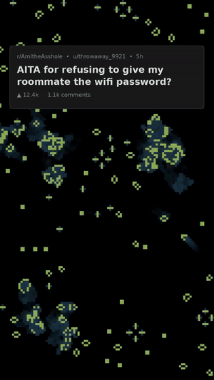
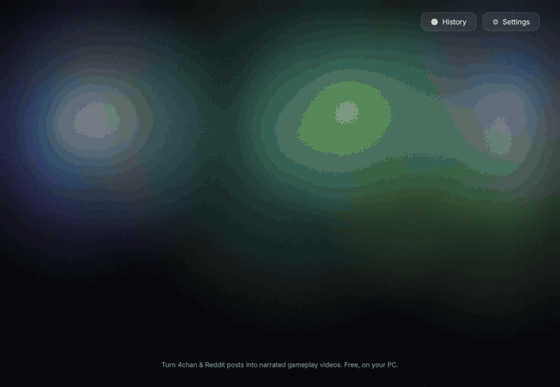

# Anon Brain
*Posts in, videos out.*

> Vibe coded with Claude Opus 5.5.

Turns a 4chan / Reddit post screenshot plus your gameplay into a narrated
video (vertical for TikTok / Shorts / Reels, or square, portrait or widescreen), with the post's lines revealed as they're read.

## Install
1. **[⬇ Download the latest version](https://github.com/SillyUserBrain/Anon-Brain/releases/latest)**
   (the `Anon-Brain-Setup-….exe` file) and run it. No admin rights needed, and
   everything it needs is built in.
2. Windows may say **"Windows protected your PC"** because the app isn't signed:
   click **More info → Run anyway**.
3. A short tour shows you around the first time. Anon Brain is 100% free: its
   free voices run on your PC (they download once, about 120 MB, the first
   time you use one). For ElevenLabs voices, add your API key in **Settings**.

New versions show **New update available** in the top-right corner; **Update
now** installs them without losing anything. Windows 10 or 11 (64-bit).

## Making a video

1. **Gameplay**: pick a folder of recordings (best) or a single clip. Each video
   gets footage no other video has used, unless you tick **Allow repeats**.
2. **Post**: drop in the screenshot, paste one (Ctrl+V or **Paste**), or paste
   a Reddit / 4chan link (share links like reddit.com/r/x/s/… work too): the app draws a clean card with the exact text and
   lets you pick replies / comments to include. **＋ Add a reply (thread)** makes a thread:
   the posts are read one after another (each can have its own voice in step 4).
   Screenshots: The text is read automatically, one line
   per line on screen (wrapped greentext stays one line); fix anything it got
   wrong in the text box.
3. **Layout**: pick the shape (9:16, 4:5, 1:1 or 16:9) and quality, then drag
   the post around the phone preview. Drag a corner to resize; Top / Center /
   Bottom snap it into place and Reset puts it back. Each shape remembers its
   own layout. **Style** has corners, shadow, border and the **text reveal**
   (*Fade in each line*, *Slide down*: the post is cropped and the crop glides
   down to each line as it's read, or *Show whole post*); **Brand** has your
   handle (watermark) and an end card, with font, size, color, opacity and
   look. Drag them on the phone or use the 9 snap spots. **Captions** swaps the
   post for big word-by-word captions, or shows the post first and then
   captions, in any font on your PC.
4. **Voice & Music**: *Narrator* is the voice (free, ElevenLabs, or one of
   your own), its speed and the pause between lines. *Music & mix* is the song
   and both volumes: hit **Preview mix** and drag the sliders while it plays.
   Drag the highlighted part of the song's waveform to choose which part plays
   (**Hear this part** plays it from there). Or **Choose folder…** for a folder
   of songs: every video gets a random song, from a random part, and a song
   won't repeat until the others have had a turn (tick **Allow repeats** if you
   don't mind; Automate uses all of this too, through your preset). **Preview** then **Make video** keep the same song.
5. **Render**: check the summary (each **Edit** jumps to that step), the
   length and which apps it fits, then hit **Make video**. When it's done, **Make another** keeps your
   gameplay, voice and music and jumps back to step 2.

  
  &nbsp;
  

## Length, speed and shortcuts
- **Length** (step 5) shows how long the video will be and which apps take it:
  YouTube Shorts 3:00 (vertical / square only), TikTok 10:00 in-app (60:00
  uploads), Instagram Reels 3:00, Facebook Reels 1:30, Snapchat Spotlight
  1:00, X free 2:20. Pick the app you're making it for: if it's too long,
  **Speed voice up** fits it (up to 1.3×). Voice speed is also on step 4.
- **Always at least** (step 5, and Automate → Video): short stories keep
  going after the voice ends, with the gameplay and music carrying on until the
  video reaches 1:00 (or 1:05, just over a minute for TikTok Creator Rewards,
  1:30, 2:00). The voice is never slowed down; the end card moves to the end.
- **Undo / redo** on the Layout step (Ctrl+Z / Ctrl+Y). **F1** lists every
  keyboard shortcut.
- **Faster renders**: Settings → Saving & speed → *Render with*. Automatic uses your
  NVIDIA, AMD or Intel graphics card when it works, and the processor
  otherwise (it also switches back by itself if the card ever fails).

## Automate (⚡ in the top bar, Ctrl+Shift+A)
Give it subreddits and it finds posts, makes videos and posts them on a schedule.

- **Find posts**: subreddits, Top/Hot/New, minimum upvotes and comments, age,
  length, words to skip. **See what it would pick now** shows every post it
  looked at and why each was skipped. Posts too long for the apps you post
  to are skipped. Long posts are split into several cards that fit the screen.
- **Video**: which preset to use (voice, music, layout, style, watermark),
  the gameplay folder, and how many videos each run.
- **Post to**: TikTok, YouTube Shorts and Instagram Reels. Each has
  **Auto-post**: on = posts as soon as it's made, off = waits in **Review**
  for you to approve. **Connect…** walks you through making your own free
  developer app for each (needed by the sites' rules):
  - TikTok: *Send to my inbox* works right away (you tap Post in TikTok).
    *Post directly* only posts privately until TikTok reviews your app.
  - YouTube: uploads stay private until Google reviews your project (one click
    in YouTube Studio makes them public). About 6 uploads a day.
  - Instagram: needs a Professional account linked to a Facebook Page.
- **Schedule**: times and days. With *Keep running in the tray*, closing the
  window keeps it going; *Start with Windows* starts it in the tray.
- **Review** (the number on the ⚡ button): watch, edit the caption, approve,
  skip. **Log** lists everything it did. It never makes the same post twice.
- Keys and sign-ins are kept in Windows Credential Manager. You can also
  connect or disconnect accounts in Settings → Accounts.

## Presets
**★ Presets** (top bar) saves your whole look under a name: shape, quality,
layout, style, reveal, voice, pauses, volumes, music, watermark and end card.
Apply one in a click. In a batch, each video can use a different preset.

## Good to know
- **No repeated footage.** In library mode, every video uses a part of your
  recordings that hasn't been used yet. To reuse footage, tick **Allow
  repeats** or click **Reset used footage** on step 1.
- **ElevenLabs credits** are only spent once per post. Previewing and then
  rendering the same text reuses the same narration.
- **Text cleanup** (Settings → Text cleanup): shorthand on the left is read
  as the words on the right. Edit cells, add rows with **+**, sort by newest
  or A–Z.
- **Pauses**: each line is voiced separately with a pause between (adjustable
  on step 4). Inside a line, a comma adds a short breath and "..." a longer one.
- **No voice** makes a silent video with the timed reveal.
- **Your own voices** (Settings → Voices, or "＋ Add your own voice…" in the
  voice list): ElevenLabs voice IDs, Piper voice files (.onnx + .onnx.json),
  Kokoro voice files (.npy / .bin), a mix of two free voices, or any server
  with an OpenAI-style `/v1/audio/speech` address. Piper installs itself the
  first time you add a Piper voice.
- Your settings, cleanup list and footage history are stored in
  `%APPDATA%\AnonBrain`. Your API key is stored in Windows Credential Manager.

## Something not working?
Settings → About → **Copy error details** (also offered next to error messages
and in the crash window), then paste it into a new
[issue](https://github.com/SillyUserBrain/Anon-Brain/issues). It never
includes your keys or sign-ins.

## Running it from the code
To run it with Python, build the installer yourself or work on the code, see
**[BUILDING.md](BUILDING.md)**.
